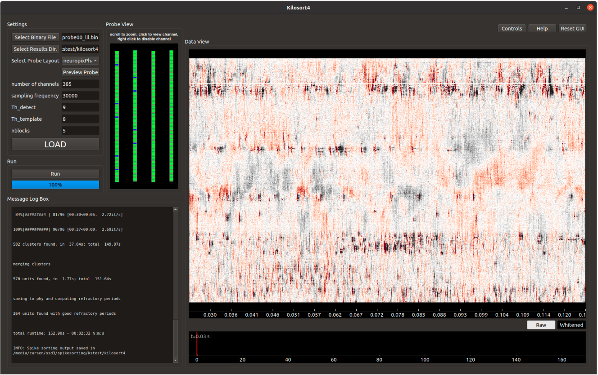

## Code

<video src="https://www.cellpose.org/static/images/cp1_1.mp4" loop autoplay muted playsinline></video>

Works on 2D and 3D data without needing 3D labels. The GUI handles manual labeling and curation, can train new models on your own images, and can denoise, deblur or upsample them. Developers have integrated it into CellProfiler, ImagePy, ImJoy, aPeer and Napari. Try it on <a href="https://huggingface.co/spaces/mouseland/cellpose">hugging-face</a>.

<h3><a href="https://github.com/mouseland/cellpose">Cellpose</a></h3>

Generalist deep-learning segmentation that works across a wide range of image types.

GPU-accelerated for speed and accuracy. It detects spikes, uses them for drift correction (essential in most recording setups), then clusters them with novel graph-based methods. Kilosort4 is written in Python with an easy-to-use GUI.

<h3><a href="https://github.com/mouseland/kilosort">Kilosort</a></h3>

The most widely used spike sorter for Neuropixels probes, and it works on others too.

Runs on standard workstations, faster than real time, recovering about twice as many cells as previous methods. Routinely detects ~25,000 cells at once from standard resonant-scanning microscopes, including axons, boutons, dendrites and spines. Extensive GUI for exploring the data.

<h3><a href="https://github.com/mouseland/suite2p">Suite2p</a></h3>

Complete two-photon pipeline: registration, cell detection, traces and spike times.

Applies SVD to facial motion for a 500-dimensional summary of the mouse's movements, and tracks keypoints with a deep network. A 1D convolutional network then predicts neural activity from either, twice as accurately as previous approaches.

<h3><a href="https://github.com/mouseland/facemap">Facemap</a></h3>

Extracts orofacial behavior from face videos and predicts neural activity from it.

Combines manifold discovery with clustering, using both instantaneous and cross-correlations between clusters, then upsamples the sorting so each neuron sits at its most correlated position. Finds VR-corridor sequences that t-SNE and UMAP miss. Runs in a notebook, its GUI, or inside Suite2p.

<h3><a href="https://github.com/mouseland/rastermap">Rastermap</a></h3>

Visualizes large-scale neural activity with a one-dimensional manifold embedding.

## Datasets

Du et al2025

<h3><a href="https://janelia.figshare.com/articles/dataset/Towards_a_simplified_model_of_primary_visual_cortex/28797638">Visual response dataset</a></h3>

29,000 neurons in mouse primary visual cortex responding to up to 65,000 natural images.

<a href="https://github.com/mouseland/minimodel">analysis code</a>

Zhong et al2025

<h3><a href="https://doi.org/10.25378/janelia.28811129.v1">Visual learning dataset</a></h3>

50,000+ neurons recorded simultaneously in mouse visual cortex as mice undergo unsupervised and task learning in virtual reality.

<a href="https://github.com/mouseland/zhong-et-al-2025">analysis code</a>

Syeda et al2024

<h3><a href="https://janelia.figshare.com/articles/dataset/Facemap_a_framework_for_modeling_neural_activity_based_on_orofacial_tracking/23712957">Facemap dataset</a></h3>

Spontaneous activity from 50,000+ neurons in mouse visual and sensorimotor cortex, with simultaneous face camera recordings and a keypoint tracking training set.

Stringer et al2021

<h3><a href="https://figshare.com/articles/Recordings_of_20_000_neurons_from_V1_in_response_to_oriented_stimuli/8279387">Neural responses to oriented stimuli</a></h3>

20,000+ neurons in mouse primary and higher-order visual cortex.

<a href="https://github.com/mouseland/stringer-et-al-2019">analysis code</a>

Stringer, Pachitariu et al2019

<h3><a href="http://dx.doi.org/10.25378/janelia.6163622.v6">Spontaneous neural activity in V1</a></h3>

10,000 neurons in visual cortex during spontaneous behaviors.

<a href="https://github.com/MouseLand/stringer-pachitariu-et-al-2018a">analysis code</a>

Stringer, Pachitariu et al2019

<h3><a href="http://dx.doi.org/10.25378/janelia.6845348.v4">Neural responses to natural images</a></h3>

10,000 neurons in primary visual cortex responding to 2,800 natural images.

<a href="https://github.com/MouseLand/stringer-pachitariu-et-al-2018b">analysis code</a>

Steinmetz et al2019

<h3><a href="https://figshare.com/articles/Eight-probe_Neuropixels_recordings_during_spontaneous_behaviors/7739750">Eight-probe Neuropixels recordings</a></h3>

Recordings during spontaneous behaviors, collected by Nicholas Steinmetz, from Stringer, Pachitariu et al 2019.

Pachitariu et al2018

<h3><a href="https://figshare.com/articles/Recordings_of_10k_neurons_in_V1_during_drifting_gratings/6214019">V1 responses to drifting gratings</a></h3>

10,000 neurons in mouse V1 during drifting gratings.

Stringer et al2021

<h3><a href="https://www.cellpose.org/dataset">Cellpose training data</a></h3>

70,000 segmented cells and other objects, the training set behind the Cellpose algorithm.

Pachitariu et al2024

<h3><a href="https://janelia.figshare.com/articles/dataset/Simulations_from_kilosort4_paper/25298815">Kilosort4 ephys simulations</a></h3>

Simulated electrophysiology recordings used to benchmark spike sorting in the Kilosort4 paper.

