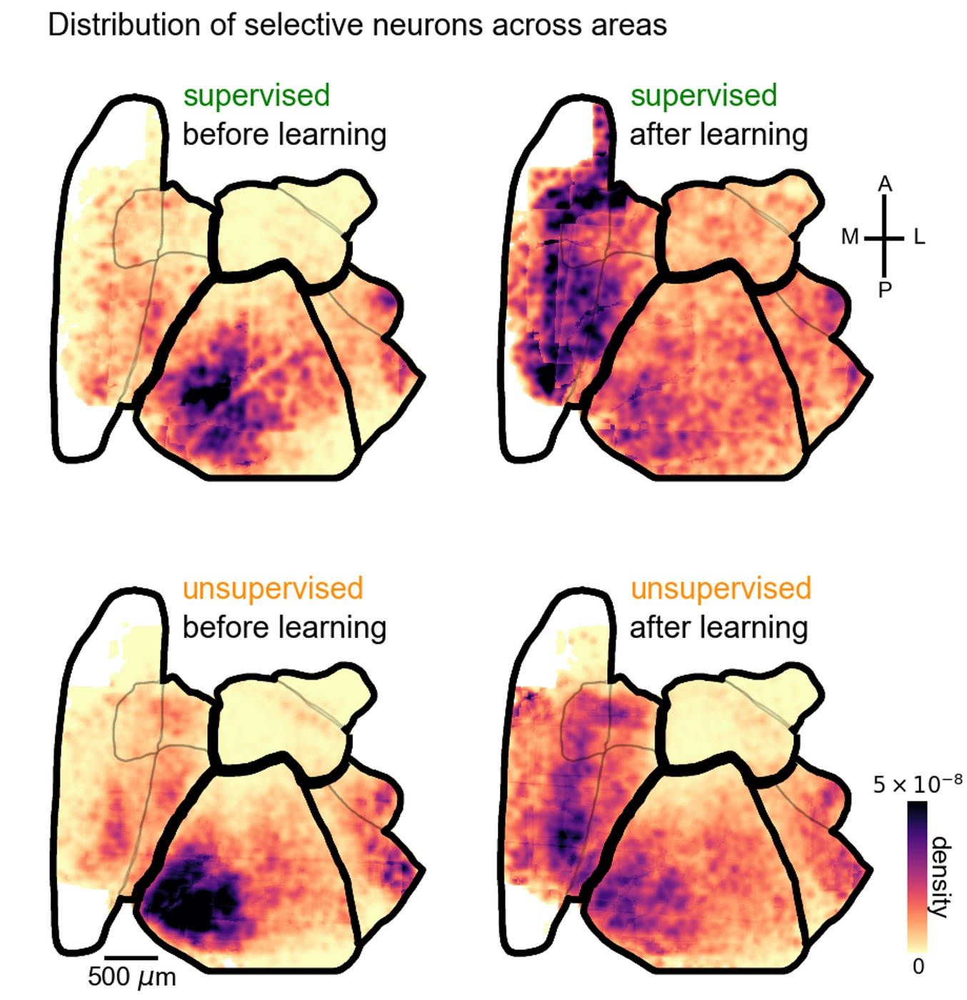
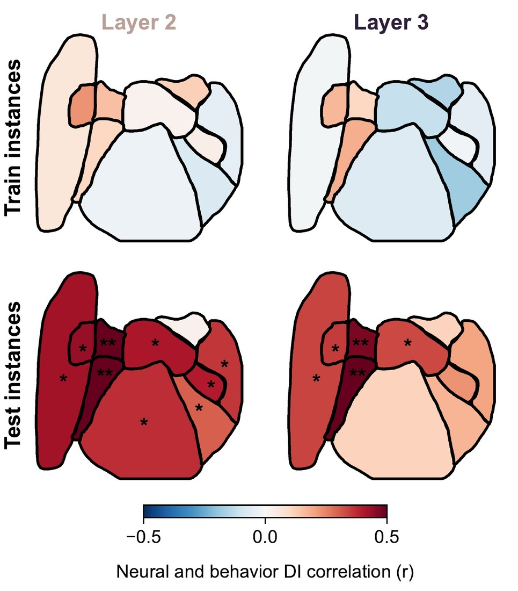
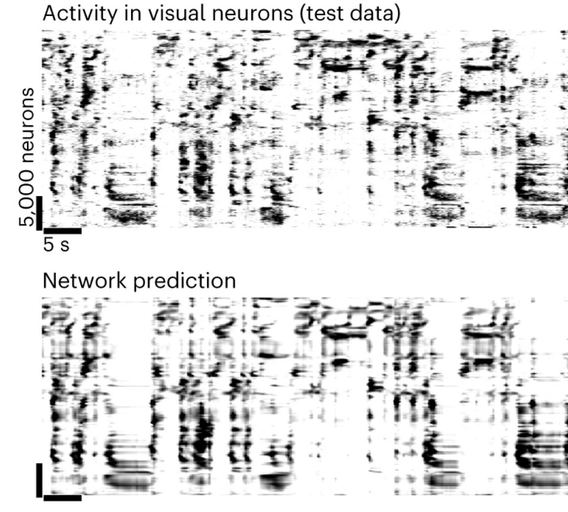
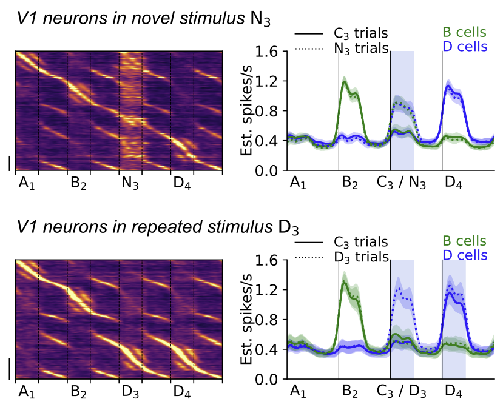

  <h1>Pachitariu + Stringer lab</h1>
  
We record tens of thousands of neurons at once in behaving mice, to determine how visual cortex represents the world, how neural responses change during learning, and how those changes arise from underlying synaptic plasticity. We also build and maintain analysis pipelines: <a href="research/posts/suite2p.html">Suite2p</a>, <a href="research/posts/kilosort.html">Kilosort</a>, <a href="research/posts/cellpose.html">Cellpose</a>, <a href="research/posts/facemap.html">Facemap</a> and <a href="research/posts/rastermap.html">Rastermap</a>.

<h2>Join us</h2>

We are recruiting postdocs in systems neuroscience.

<a class="btn-lab" href="positions.html">See open positions</a>

  <video width="100%" autoplay loop muted playsinline controls alt="50,000 neurons recorded with two-photon calcium imaging from mouse visual cortex">
    <source src="https://github.com/MouseLand/MouseLand.github.io/releases/download/v0.1/Movie1.mp4" type="video/mp4">
  </video>
  
50,000+ neurons recorded simultaneously at 3 Hz with two-photon
  calcium imaging, in mouse visual cortex.

## Example projects in the lab

<a class="theme-card" href="research/posts/unsupervised.html">

<h3>How does cortex learn without supervision?</h3>

Mice exposed to stimuli with no task and no reward still reorganize their visual representations.

</a>
<a class="theme-card" href="research/posts/generalization.html">

<h3>Which visual areas predict how well mice generalize?</h3>

Neural discrimination of novel test images, but not of trained images, predicts how well mice generalize.

</a>
<a class="theme-card" href="research/posts/facemap.html">

<h3>How much of cortical activity reflects behavior?</h3>

Ongoing orofacial movements account for a large fraction of variance across the brain, including in primary sensory areas.

</a>
<a class="theme-card" href="research/posts/spatialpred.html">

<h3>Does cortex predict in space or in time?</h3>

Mismatch responses in visual cortex turn out to signal spatial novelty, not violated temporal expectations.

</a>

Browse [all research](research/index.qmd), the [full publication list](research/publications.qmd),
or the [raw data](code_and_data.qmd).

## Recent news

::: {.news-list}
- Miguel Angel Nuñez-Ochoa et al., preprint out on [Linking neural representations to behavior using generalization](https://www.biorxiv.org/content/10.64898/2026.04.21.719991v1.abstract).
- Paul K LaFosse et al., preprint out on [Raster photostimulation of large-scale neural populations](https://www.biorxiv.org/content/10.64898/2026.04.21.719951v1.abstract).
- [A critical initialization for biological neural networks](https://www.nature.com/articles/s41586-026-10528-1) published in *Nature*, with all [data](https://doi.org/10.25378/janelia.27854448) and [code](https://github.com/MouseLand/critical_init) released.
- Atika Syeda et al., preprint out on [Orofacial behaviors, not eye movements, govern neural activity in mouse visual cortex](https://www.biorxiv.org/content/10.64898/2026.02.04.703800v1.abstract), also presented at Cosyne.
- Lin Zhong et al. on [unsupervised pretraining in biological neural networks](https://www.nature.com/articles/s41586-025-09180-y), published in *Nature*.

:::

[All news, talks and media coverage →](news.qmd)
