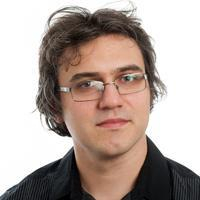
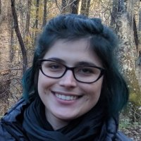
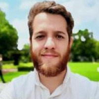
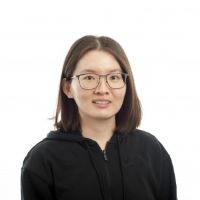
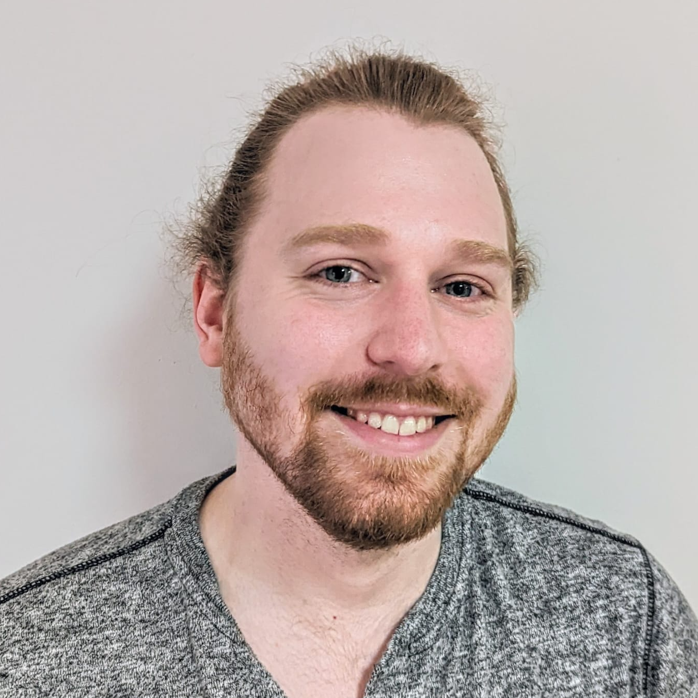
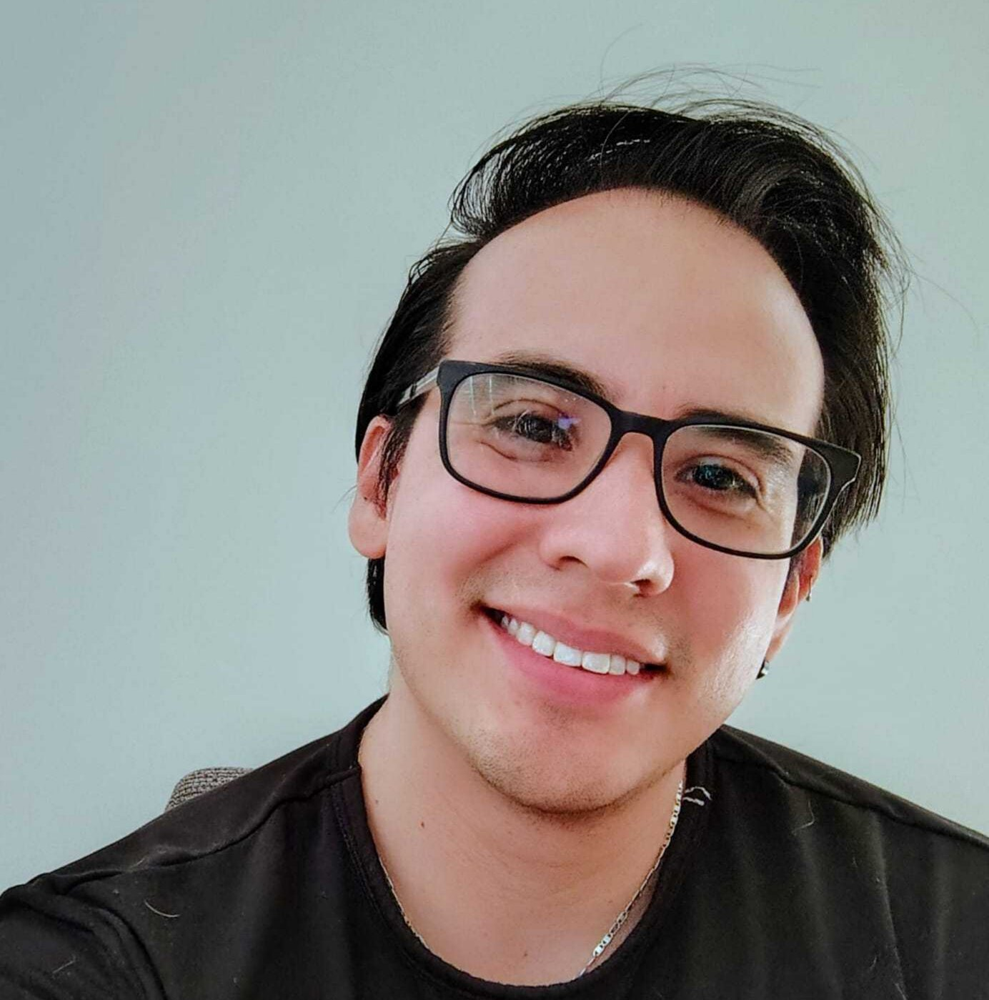
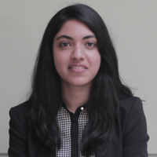
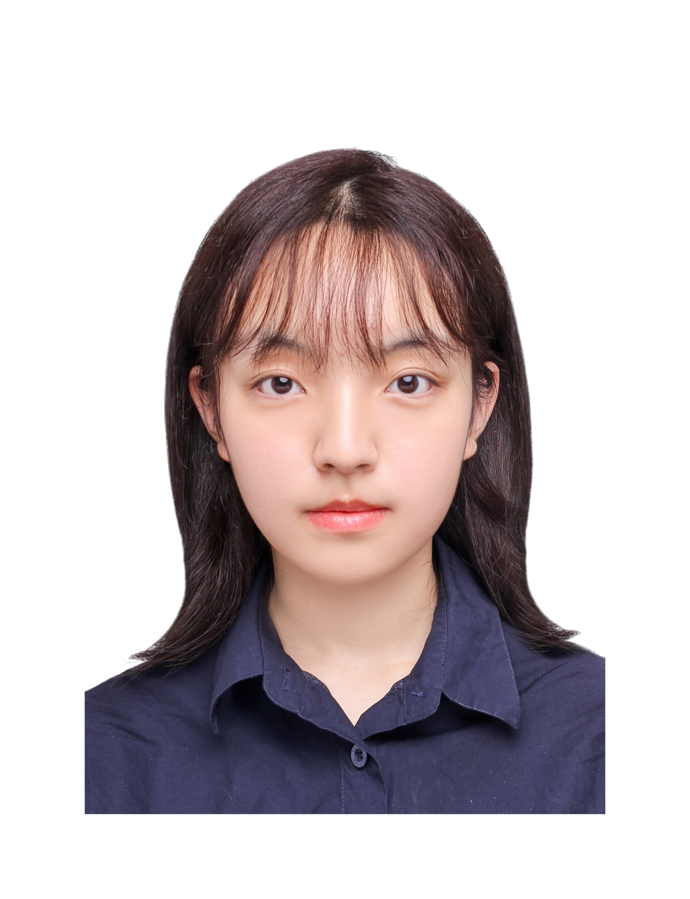
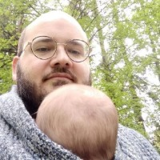
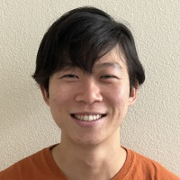

## Group leaders

  <a href="marius.html">
    
    Marius Pachitariu
    Group leader
  </a>

  <a href="carsen.html">
    
    Carsen Stringer
    Group leader
  </a>

## Postdocs

  <a href="https://www.janelia.org/people/miguel-angel-nunez">
    
    Miguel Angel Nuñez-Ochoa
    Linking neural representations to behavior
  </a>

  <a href="https://www.janelia.org/people/qingqing-zhang">
    
    Qingqing Zhang
    Predictive coding in visual cortex
  </a>

  <a href="https://scholar.google.com/citations?user=JflWW-YAAAAJ&hl=en">
    
    Paul LaFosse
    Large-scale photostimulation
  </a>

  <a href="https://www.janelia.org/people/benjamin-arroyo">
    
    Benjamin Arroyo
    Neural activity in freely moving mice
  </a>

## PhD students

  <a href="https://www.janelia.org/people/atika-ibrahim-syeda">
    
    Atika Syeda
    Orofacial behavior and cortical activity
  </a>

  <a href="https://www.janelia.org/people/ruoxi-sun">
    
    Ruoxi Sun
    Context-dependent coding in visual cortex
  </a>

## Software engineers

  
  Jacob Pennington
  Kilosort

  <a href="https://chriski.me/">
    
    Chris Ki
    Suite2p &middot; part-time
  </a>

## Where our alumni go

**To faculty positions**

::: {.alumni-list}
- [Lin Zhong](https://itbr.fudan.edu.cn/en/info/3477/22351.htm), postdoc &rarr; Assistant Professor, Institute for Translational Brain Research, Fudan University
- [Tosif Ahamed](https://tosifahamed.github.io/), theory fellow &rarr; Assistant Professor, Department of Bioengineering, Indian Institute of Science, Bangalore

:::

**To PhD programs**

::: {.alumni-list}
- Will Long, research technician &rarr; PhD, Princeton
- Renee Tung, research technician and summer student &rarr; MD-PhD, Columbia
- Sonia Joseph, research technician &rarr; PhD, Mila

:::

**Other alumni**

::: {.alumni-list}
- Fengtong Du, PhD student &rarr; AI Engineer, AI@HHMI
- Michael Rariden, software engineer &rarr; Scientific Computing Associate, AI@HHMI 
- Ifedayo-Emmanuel Adeyefa-Olasupo, postdoc &rarr; Fellow, University of Oregon
- Michalis Michaelos, research technician &rarr; vivarium experimenter

:::

Interested in joining us? See [open positions](../positions.qmd).

## Previous lab visitors

- Minh Thao Nguyen, PhD student, Novak lab
- [Ondrej Novak](https://www.researchgate.net/profile/Ondrej-Novak-3)
- Beverly Seltzer, PhD student, Lewis lab
- Len Jacob, postdoc, Lewis lab
- [Laura Lewis](https://www.lewisneurolab.org/)
