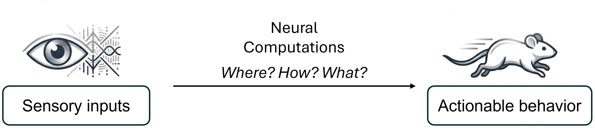
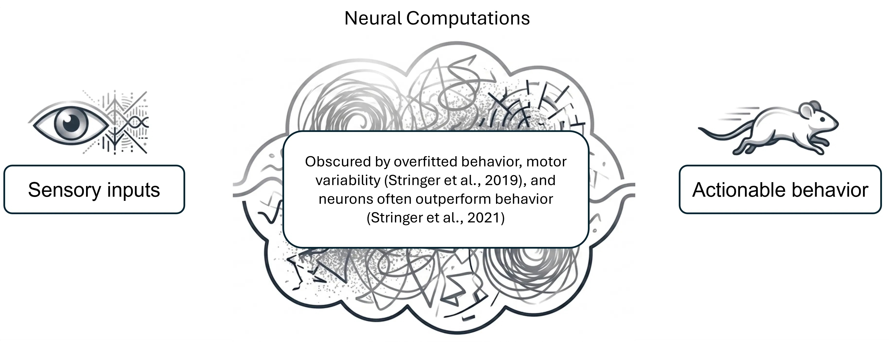
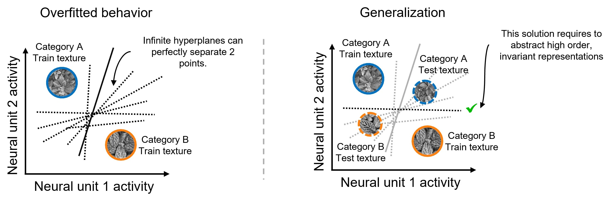
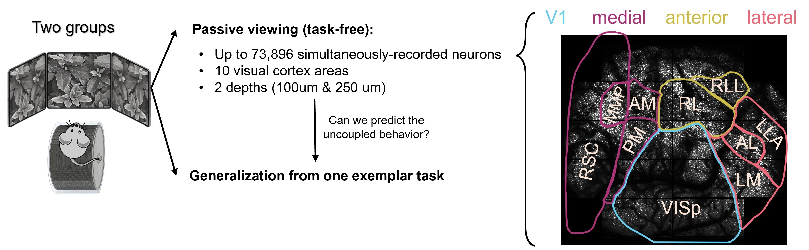
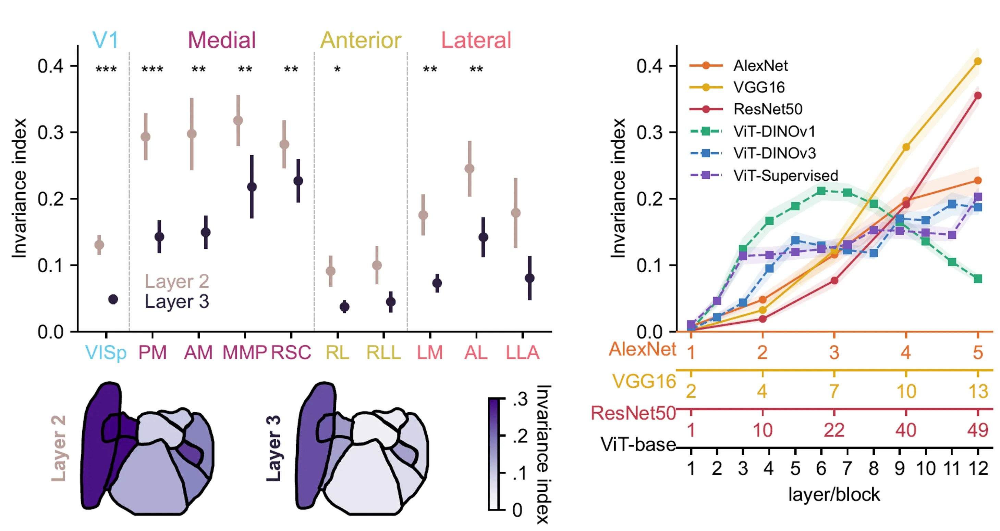
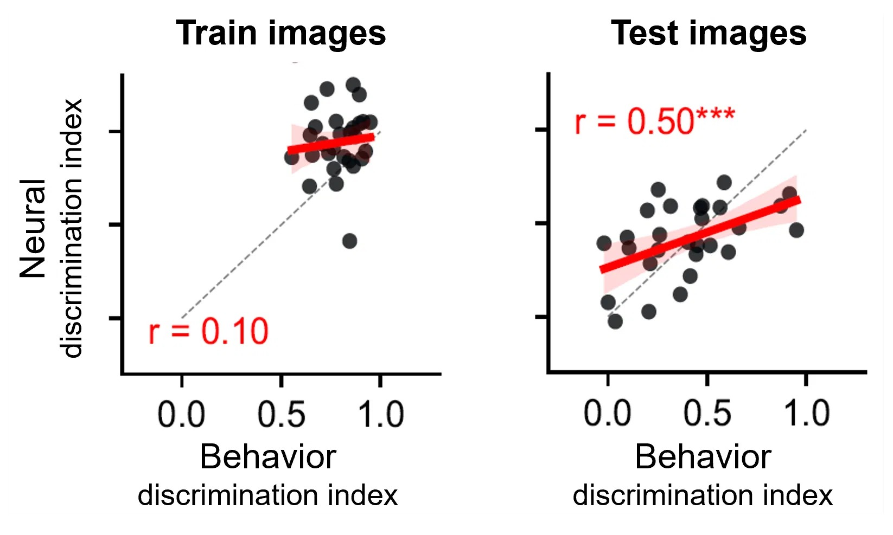
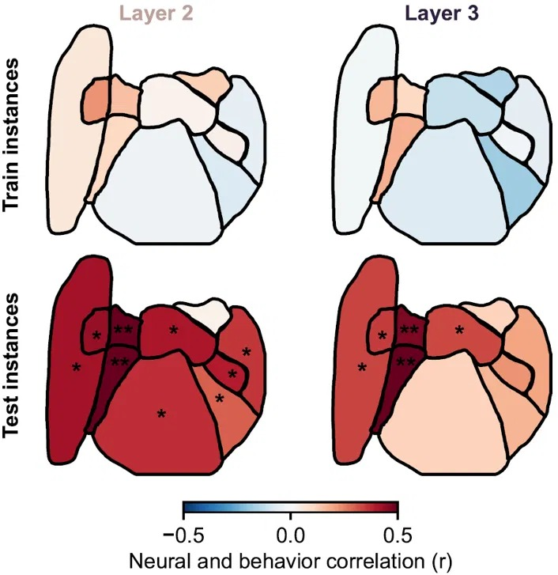

  

Abstract

  

Sensory-guided decisions are the result of sensorimotor transformations across many brain areas. Recent studies have localized the motor- and decision-related components of these transformations using brain-wide neural recordings. It has been more difficult to localize sensory computations in the same way. Here we developed a new approach for linking sensory computations to behavior by training mice to discriminate between two stimuli and testing their responses with new stimuli. In separate animals, we calculated the similarity of neural representations between train and test stimuli, using recordings of up to 73,000 simultaneously-recorded neurons from 9 primary and higher-order visual areas (HVAs) across layers 2 and 3. We found that neural discrimination on test but not train images correlated with behavioral discrimination, and this relation required prior visual experience as it was not present in dark-reared mice. The link between neural and behavioral performance was highest in the medial HVAs, suggesting this region is a critical component of sensory transformations and generalization.

<a href="https://www.biorxiv.org/content/10.64898/2026.04.21.719991v1">preprint</a>

[Thread](https://bsky.app/profile/nunezkant.bsky.social/post/3mmrsoovrrc2v) by Miguel Angel Nuñez-Ochoa:

1. 🚨🚨Preprint alert!

   "Perfect" isn't always smart 🧠. Anyone can tell apart two stimuli (including our mice). But how do we extract rules that apply to new stimuli? 🧵

   [biorxiv.org/content/10.64898/2026.04.21.719991v1](https://biorxiv.org/content/10.64898/2026.04.21.719991v1)

   [@marius10p.bsky.social](https://bsky.app/profile/marius10p.bsky.social) [@computingnature.bsky.social](https://bsky.app/profile/computingnature.bsky.social)
   #neuroAI #neuroscience #AI

2. Traditionally, in systems neuroscience, we aim to find maps from sensory inputs to actionable behavior, determine where the computations happen, how neurons perform those computations, and what action results from those computations.

3. The problem? Previous work has shown that neural population coding is far more precise than animal behavior, and non-sensory "noise" from behavior can easily contaminate the data.

4. Here, we also propose that by inspecting neural activity mainly on behaviorally “optimal” animals, we might be missing where the computations happen.

5. If we only look at the brain during "train" images, we might just be seeing neurons in a regime of overfitted behavior rather than sensory processing. To solve this, we took a page out of the AI playbook: we tested mice on out-of-sample generalization.

6. We looked at two groups of mice:

   - A naive group (task-free) where we mapped invariance to natural images across 10 visual areas.
   - A behavioral group trained on just one pair of images and then tested on their ability to generalize to a new pair.

7. This "one-shot" style task is a massive challenge. Since the mice only see one image per category during training, they can’t just "memorize" a rule; they have to rely on their prior, internal representations to solve the problem.

8. First, we measured how category invariance was distributed across visual areas. We found two things: invariance was higher in the medial areas and in the superficial populations, comparable to intermediate and deep layers of CNNs and transformers.

9. Second, we asked if we could use the representation space of the naive (task-free) group to predict the behavioral choices in the task group. Indeed, we could. But there was a catch: this prediction only worked based on the "test" images.

10. On "train" images, both the brain and behavior are nearly perfect decoders, leaving no variability to analyze. Intelligence and true sensory computations are revealed by "out-of-sample" generalization, where the system is truly challenged.

11. So, where does this happen? Categorical information is widespread in layer 2 (~100 µm deep), but also present in deeper layers of the medial higher-order visual areas (HVAs).

 
